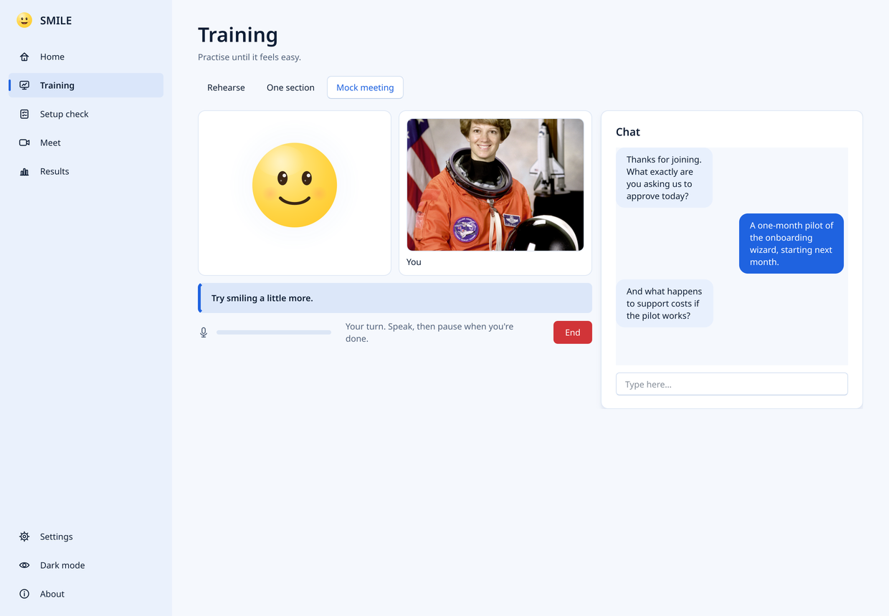
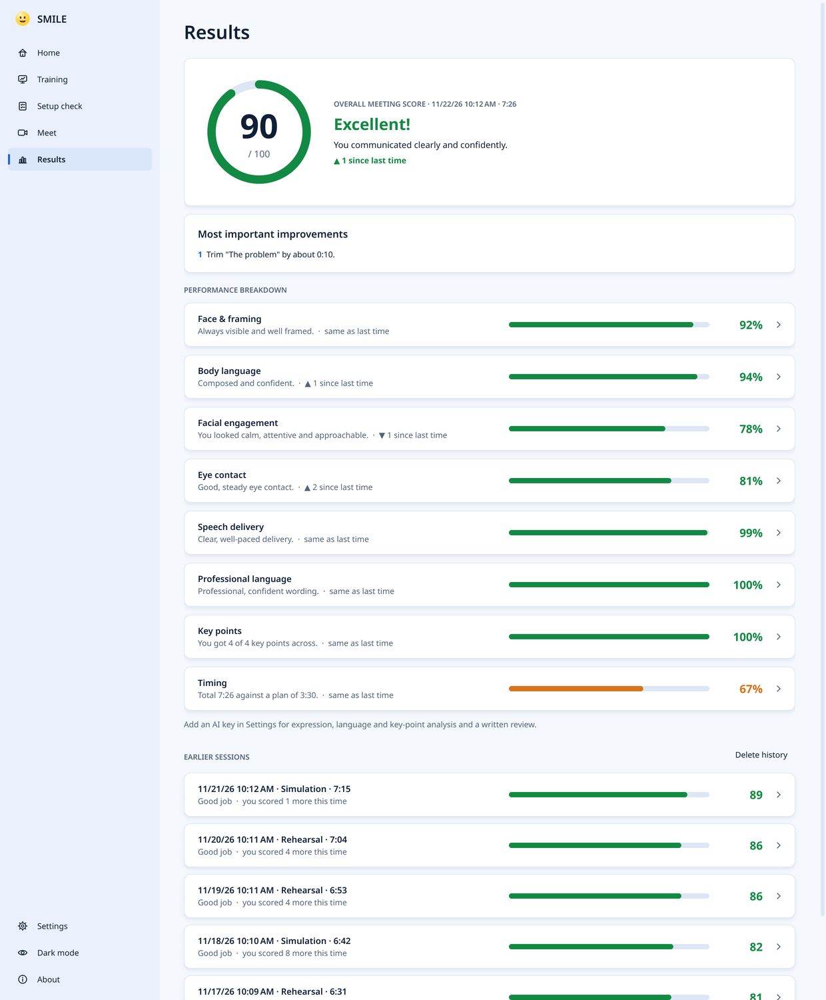
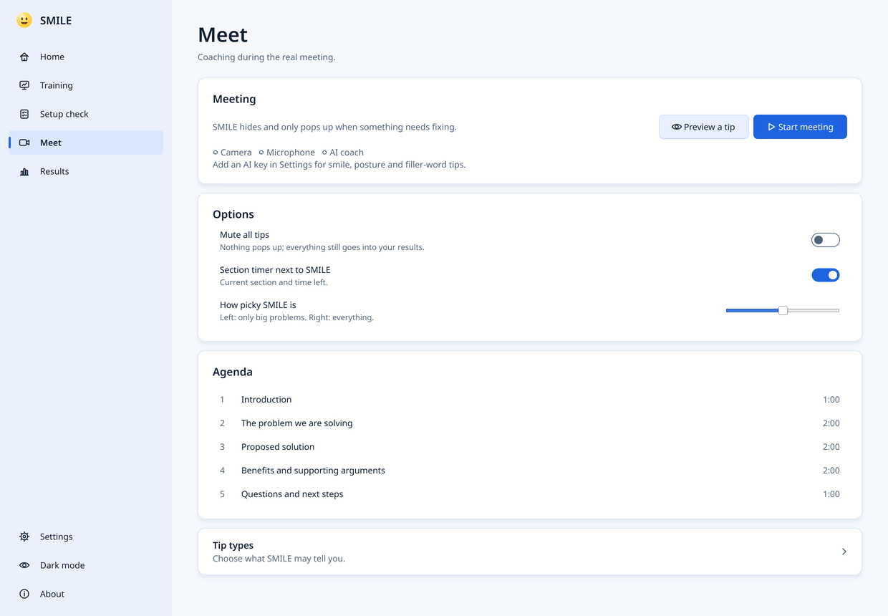

# S.M.I.L.E.

**Smart Meeting Interactive Live Education**

SMILE is a desktop coach that helps you **correct your body behaviour in online meetings** such as job interviews, client pitches and presentations. It watches and listens through your webcam and microphone, coaches you while you train, checks your setup before a call, gives a few quiet nudges during it, and scores you afterwards. Only you see it.

> SMILE only reads your camera and microphone. It never alters, filters or overlays your outgoing video, never joins the meeting as a bot, and never records to disk.

**Download:** Windows (`.zip`), macOS (universal `.dmg`) and Linux (`.AppImage`) builds are attached to every [GitHub release](../../releases).

<p align="center"></p>

| Home | Mock meeting |
|---|---|
|  |  |
| **Results** | **Meet** |
|  |  |

---

## What SMILE focuses on

Live, SMILE only talks about how you come across on camera, in this order of importance:

1. **Face covered or out of frame**: a hand over your face, leaning out of the picture.
2. **Posture and movement**: slouching, a tilted head, fidgeting, distracting hands.
3. **Eye contact**: looking away from the camera, or reading for too long.
4. **Filler words**: "um", "uh", "you know".
5. **Smile and expression**: no smile for a long time, or a tense look.
6. **Holding the floor**: talking for about 3 minutes without a break for others: *"Pause and ask for questions."*

Everything else (timing, key points, pace, wording, lighting, clothing) never pops up during a session. It is measured and waits for your results.

---

## The app

| Page | What it's for |
|---|---|
| **Home** | Four big buttons (Practise, Check my setup, Start a meeting, My results) plus your progress: level and XP, day streak, last and best score, a score chart, badges and recent sessions. |
| **Training** | **Rehearse** your whole talk against your plan; practise **one section** at a time; or run a **mock meeting** with SMILE as the other person (presentation, interview, negotiation, business proposal, sales pitch). |
| **Setup check** | A live camera preview and a one-click AI check of framing, camera angle, lighting, collar, posture and clutter, with red boxes on what to fix. A live sound check tells you if there's background noise. |
| **Meet** | Start a real meeting. SMILE minimizes; the small animated companion pops up only when something about your body language needs fixing. |
| **Results** | Your score, the three most important things to work on, a breakdown you can expand into exact measurements and timestamped moments, and the change since last time. Every earlier session is listed below and can be reopened to compare. |
| **Settings** | AI key, how picky SMILE is (separately for meetings and training), AI intelligence, camera and microphone, mouse haptics, appearance and debug mode. |

### Training

* **Rehearse**: paste your speech or notes. SMILE splits them into sections with key points, you adjust the sections and target times, then rehearse out loud. Training is graded more strictly than real meetings and gives more feedback.
* **One section**: practise a single section with your notes in view, get a score and try again, compared with your last attempt.
* **Mock meeting**: a video-call layout with the SMILE avatar next to your own camera. The avatar plays a role, listens, answers within a few seconds of you finishing, and asks follow-up questions. Behaviour feedback appears under your video, and **"SMILE steps in"** (Never / Light / Balanced / Strict) sets how often the avatar itself comments on a covered face, fidgeting or slouching. A banner warns you when it's too noisy around you. Headphones work best.

SMILE follows which section you're on by **meaning**, not exact words, and judges key points leniently on the idea. If you drift off your plan it notes it for the results.

### During a meeting

* There's no long quiet time between pop-ups: a tip shows as soon as its problem lasts long enough. Each kind of tip then waits before it repeats, so nothing nags.
* **How picky SMILE is** sets how long a problem must last: at the middle setting, 2 s of a covered face, 6 s looking away, 40 s without a smile, 3 minutes talking without a break. At the strictest, the smile reminder comes every few seconds.
* The most urgent tip always wins: a hidden face replaces anything else on screen.
* "Talking too long" counts only real turns: short pauses between sentences don't reset it, a few seconds of silence (someone else speaking) does, and it reminds you at most once per 3 minutes.
* Right-click the companion to **snooze tips for 10 minutes** or **mute all tips** until you unmute them. Mute is also in the tray menu and on the Meet page. Muted sessions are still scored.
* The companion is always on top but only shows its face area to the mouse, so it doesn't block clicks on your meeting app. Drag it anywhere.
* An optional section timer can sit next to it (Meet → Options).
* With an MX Master 4 and the plugin in [`integrations/logi-haptics`](integrations/logi-haptics), warnings can also pulse the mouse.

### Scoring

The overall score weighs how you come across most:

| Category | Weight |
|---|---|
| Face & framing (visible, not covered, steady) | 2.0 |
| Body language (posture, movement, hands) | 2.0 |
| Facial engagement (warmth; a calm, attentive face counts as good) | 1.5 |
| Eye contact | 1.5 |
| Speech delivery (pace, filler words, pauses, volume) | 1.25 |
| Professional language | 1.0 |
| Key points | 0.6 |
| Timing | 0.5 |

A covered face or disturbing movement also caps the overall score, so good timing can't make up for it. Training sessions need a higher score for the same rating.

---

## How SMILE watches and listens

| | On your computer | In the cloud (Together AI) |
|---|---|---|
| Camera | YuNet face tracker (~15×/s): position, landmarks, head direction. FER+ expression model (~5×/s): smile and expression. | Vision model every 2 s (adjustable to 1 s) and immediately when the tracker sees a change: posture, hands, covered face, tension. |
| Voice | Speech detection tuned to ignore background noise, talk time, pauses, speaking rate, noise level. | Whisper: exact words, filler words, words per minute. |

The cloud results calibrate the local ones as you go. **Debug mode** (Settings) shows the tracking points, live values, raw AI answers and the reason behind every tip.

---

## AI coach setup

SMILE's smart features use [Together AI](https://together.ai). The key is **never** built into the app or committed to git. SMILE looks for it in this order:

1. **Settings → AI coach**: paste it in the app. It's stored only on that computer.
2. The `TOGETHER_API_KEY` environment variable.
3. A `.env` file in the working directory or next to the app (copy `.env.example` to `.env`). `.env` is git-ignored.

**AI intelligence** (Settings → Coaching):

| Level | Models | Cost |
|---|---|---|
| Standard (default) | `nvidia/NVIDIA-Nemotron-3.5-Super-VL` (camera), `openai/gpt-oss-120b` (text) | about $0.15–0.25 per hour |
| Enhanced | `moonshotai/Kimi-K3` | ~5× |
| Maximum | `moonshotai/Kimi-K3.1-Pro` | ~15× |

Speech always uses `openai/whisper-large-v3`, the mock meeting's conversation always uses the fast `gpt-oss-120b`, the avatar speaks with `hexgrad/Kokoro-82M`, and the setup check always uses the quick vision model so it answers in a second or two.

---

## Privacy

* Video and audio are processed on your computer. While a session runs, a small snapshot every couple of seconds and short speech clips are sent to Together AI over HTTPS for analysis. Nothing is stored in the cloud. Switch **Analyse with AI** off in Settings to keep everything local.
* Nothing is recorded to disk. Session results (scores and the written report, no video or audio) are saved on your computer only, and **Results → Delete history** removes them.
* There are no accounts.

---

## Building from source

Requirements: CMake 3.21+, a C++17 compiler, Qt 6.8+ (Widgets, Multimedia, Network) and Python 3.

```bash
python3 scripts/fetch_onnxruntime.py
cmake -B build -DCMAKE_BUILD_TYPE=Release
cmake --build build -j
./build/SMILE
```

ONNX Runtime is loaded at run time, so SMILE still starts without it (without on-device tracking). The FER+ expression model is downloaded and checked by CMake at configure time. GitHub Actions builds and publishes all three platforms when a `vX.Y.Z` tag is pushed.

Handy environment variables: `SMILE_THEME=light|dark`, `SMILE_COMPANION_INPROCESS=1` (run the companion inside the main process), `SMILE_MUTE_AUDIO=1` (silent avatar, for demos and tests).

### Layout

```
src/app         main window, pages (Home, Training, Setup check, Meet, Results, Settings), session history
src/companion   the floating companion (separate process) and its avatar
src/core        session controller, settings, tips, reports
src/sensors     camera and microphone
src/vision      on-device face tracking and expression model
src/ai          Together AI client, vision and speech coaching, mock meeting, key-point judge
src/ui          theme and widgets
integrations    Logi Options+ plugin for mouse haptics
```

---

<sub>*S.M.I.L.E.: because being Supercalifragilisticexpialidocious in meetings takes practice.*</sub>
