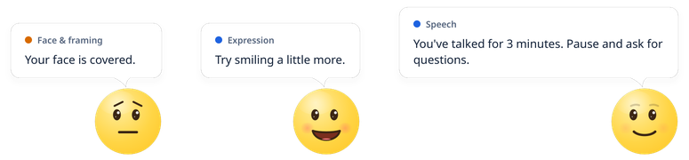
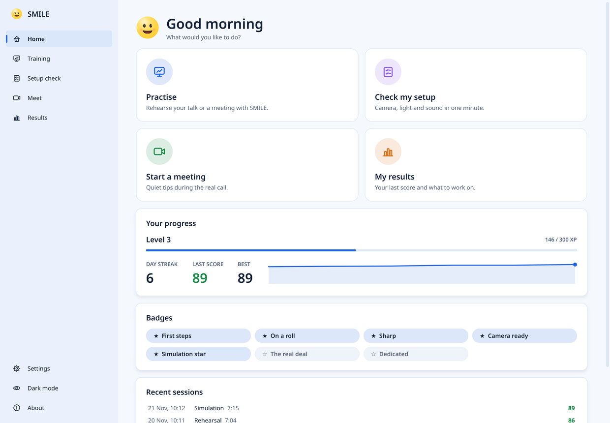

# S.M.I.L.E.
### Smart Meeting Interactive Live Education

**Turn every online meeting into an opportunity to become a better communicator.**

## Project Introduction

Whether pitching to a client, interviewing for a job, presenting to stakeholders or leading an important meeting, how you communicate matters just as much as what you say.

SMILE is an AI-powered desktop coach designed for **high-stakes presenters, professionals and organisations** who want to improve how they communicate online.

We believe that becoming a better presenter shouldn't mean memorising a checklist or watching hours of generic tutorials. People learn best by practising in realistic situations, receiving feedback that adapts to their individual behaviour, and seeing their progress over time.

SMILE makes this possible by combining real-time multimodal AI with interactive training simulations. It observes your facial expressions, posture, gestures, eye contact and speech, providing personalised feedback while you practise and subtle reminders during real meetings.

**The key idea: learn by doing, improve through feedback, and see the difference in real meetings.**

Unlike a chatbot or traditional presentation course, SMILE creates an interactive learning experience in which your own behaviour is the material being taught. When you start slouching, covering your face or looking away from the camera, SMILE detects it and shows you what to change, right when it happens.

The goal is not to make everyone behave identically, but to help each person develop the communication style that best fits their role and objectives.

> SMILE only reads your camera and microphone. It never alters your outgoing video, joins meetings as a bot or records video or audio to disk. Only you see the coaching feedback.

---

## Technical Details & Architecture

SMILE is a native desktop application built with **C++, Qt and real-time AI**, combining local computer vision with cloud-based multimodal intelligence.

### Technology Stack

| Component | Technology | Purpose |
|---|---|---|
| Desktop application | C++17, Qt 6.8+ | Native cross-platform interface |
| Computer vision | ONNX Runtime, YuNet | Local face detection, landmarks and head tracking |
| Facial expression | FER+ | Smile and facial engagement detection |
| Multimodal AI | Together AI | Contextual analysis of posture, hands and body language |
| Speech recognition | Whisper Large v3 | Transcription, filler words and speech analysis |
| AI coaching | NVIDIA Nemotron, GPT-OSS, Kimi | Personalised feedback and behavioural evaluation |
| Mock meeting conversation | GPT-OSS-120B | Interactive role-play and follow-up questions |
| Avatar speech | Kokoro-82M | Spoken responses from the AI meeting partner |
| Hardware integration | Logitech LogiInsight, MX Master 4 | Infrared body tracking and discreet haptic feedback |

### Architecture

SMILE combines local processing and cloud intelligence to provide responsive, context-aware coaching.

**1. Multimodal input**

The webcam and microphone continuously provide information about the user's behaviour:

- Video frames and facial landmarks.
- Head direction and facial expressions.
- Body posture, hand movements and gestures.
- Speech, pauses, filler words and speaking duration.
- Environmental noise levels.

**2. Local intelligence**

On-device models track facial position, landmarks and expressions in real time. Speech activity and timing are also processed locally.

This provides immediate behavioural signals without needing to send every frame to the cloud.

**3. Cloud-based AI analysis**

Through Together AI, SMILE periodically analyses camera snapshots and short speech clips to understand more complex behaviours, such as slouching, distracting gestures, facial tension and filler words.

Cloud analysis calibrates the local tracking and adds contextual understanding.

**4. Adaptive feedback engine**

SMILE prioritises detected behaviours according to their importance. It determines when feedback is necessary, avoids repetitive interruptions and adapts its sensitivity to the user's preferences.

**5. Learning and progress tracking**

Training sessions generate scores, detailed reports and actionable improvements. Session history allows users to compare their performance over time and understand whether their training is translating into better real-world meetings.

### Logitech Hardware Integration

SMILE explores a more intelligent way of interacting with computers by turning the webcam into a multimodal sensing device.

With the **Logitech LogiInsight prototype camera**, SMILE can use its wide-angle infrared feed to improve body tracking, including situations where the user moves outside the visible colour-camera frame. Its machine learning capabilities also offer an opportunity for future on-device processing, reducing the hardware requirements placed on an employee's personal computer.

The **Logitech MX Master 4** provides another dimension to the experience. Through an optional Logi Options+ integration, behavioural warnings can trigger haptic pulses through the mouse.

Instead of displaying distracting notifications or playing sounds during an important client meeting, SMILE can discreetly communicate that something needs attention through a physical interaction that only the user experiences.

This makes feedback more immediate without interrupting the meeting or affecting what other participants see or hear.

---

## Screenshots

### The SMILE Companion

The floating companion provides real-time behavioural feedback while remaining unobtrusive and visible only to the user.



### Application Overview

| Home | Mock Meeting |
|---|---|
|  |  |
| **Results** | **Meet** |
|  |  |

---

## Key Features

### 1. Real-Time Behavioural Coaching

SMILE observes how you present and identifies behaviours that influence how others perceive you.

It prioritises feedback in the following order:

1. **Face visibility:** Detecting when your face is covered or outside the frame.
2. **Posture and movement:** Identifying slouching, tilted heads and distracting movements.
3. **Eye contact:** Detecting when you look away from the camera or read for too long.
4. **Speech habits:** Identifying filler words such as "um", "uh" and "you know".
5. **Facial engagement:** Recognising prolonged lack of expression or facial tension.
6. **Holding the floor:** Reminding you to pause and invite questions after speaking for too long.

The feedback is prioritised to ensure the most important issue is addressed first.

During real meetings, SMILE minimises itself and only displays a reminder when a behavioural issue persists long enough to warrant attention.

### 2. Learn Through Interactive Simulations

SMILE turns presentation training into an active learning experience rather than a passive tutorial.

Users can choose between three training modes:

**Rehearse your presentation**

Upload your speech or notes. SMILE divides your presentation into sections, identifies key points and allows you to practise the entire talk while tracking your delivery.

**Practise one section**

Focus on a particular part of your presentation, receive feedback and repeat it until you improve. Your performance is compared with previous attempts.

**Mock meetings**

Enter a simulated video call where an AI avatar plays the role of an interviewer, client, business partner or stakeholder.

The avatar listens, responds naturally, asks follow-up questions and adapts the conversation to the chosen scenario.

Users can practise:

- Job interviews.
- Client pitches.
- Business proposals.
- Sales presentations.
- Negotiations.
- General presentations.

The goal is to develop good communication habits through realistic practice, not to force users into a rigid set of behavioural rules.

### 3. Personalised and Context-Aware Learning

Different people have different roles, goals and communication styles.

SMILE evaluates users in the context of what they are trying to achieve. A job interview, a client pitch and an internal presentation do not necessarily require the same approach.

Feedback is based on actual behaviour and the situation, rather than a universal yes-or-no checklist.

As users continue training, SMILE tracks their performance, identifies recurring weaknesses and highlights improvements.

### 4. Setup Check

Before an important meeting, SMILE checks whether your environment is ready.

A live camera preview and AI-powered assessment evaluate:

- Camera framing and angle.
- Lighting.
- Posture.
- Collar and clothing.
- Background clutter.

A separate audio check detects background noise.

The application highlights issues visually so users can correct their setup before joining a call.

### 5. Real-World Meeting Companion

Training is only valuable if it translates into real-world improvement.

SMILE can run alongside your existing video conferencing software without joining the meeting or modifying your outgoing video.

Its floating companion delivers discreet reminders when you need to correct your behaviour.

Users can snooze reminders, mute them entirely or adjust how sensitive the coaching should be. Sessions continue to be evaluated even when reminders are muted.

### 6. Performance Analytics

After each session, users receive a detailed report containing:

- An overall presentation score.
- The three most important areas to improve.
- A breakdown of individual performance categories.
- Detailed measurements and timestamped feedback.
- Comparison with previous sessions.

The scoring system prioritises the behaviours that have the greatest influence on how a presenter comes across.

| Category | Weight |
|---|---:|
| Face and framing | 2.0 |
| Body language | 2.0 |
| Facial engagement | 1.5 |
| Eye contact | 1.5 |
| Speech delivery | 1.25 |
| Professional language | 1.0 |
| Key points | 0.6 |
| Timing | 0.5 |

Users can track their level, XP, streaks, badges and score progression, making improvement measurable and motivating.

---

## Installation & Setup

### Download

Download the latest release for your operating system from the [GitHub Releases](../../releases) page.

| Operating System | Build |
|---|---|
| Windows | `.zip` |
| macOS | Universal `.dmg` |
| Linux | `.AppImage` |

Extract or install the application and launch SMILE.

### 1. Configure the AI Coach

SMILE uses [Together AI](https://together.ai) for its cloud-based AI coaching features.

1. Create an account at [Together AI](https://together.ai).
2. Generate an API key.
3. Open SMILE.
4. Navigate to **Settings → AI Coach**.
5. Paste your API key.

Alternatively, provide the key through the `TOGETHER_API_KEY` environment variable or a `.env` file.

The API key is stored locally and is never embedded in the application or committed to the repository.

**AI intelligence settings**

| Mode | Models | Approximate cost |
|---|---|---:|
| Standard | NVIDIA Nemotron 3.5 Super VL + GPT-OSS-120B | $0.15–0.25/hour |
| Enhanced | Kimi K3 | ~5× Standard |
| Maximum | Kimi K3.1 Pro | ~15× Standard |

Speech recognition always uses Whisper Large v3. Mock meeting conversations use GPT-OSS-120B, and the speaking avatar uses Kokoro-82M.

### 2. Configure Your Camera and Microphone

Open **Settings → Camera** and select your webcam.

For the Logitech LogiInsight prototype:

1. Connect the camera through USB.
2. Select **Logitech LogiInsight (color)** under Settings → Camera.
3. Open **Check my setup** to view the full camera frame.
4. For the infrared feed, open **Settings → Debugging → Open debug view** and enable **Show taller view**.

The infrared preview is available while the Logitech colour camera is active and its infrared feed is connected.

Select your microphone under Settings and complete the audio check.

### 3. Install the Logitech MX Master 4 Haptic Plugin (Optional)

SMILE supports optional haptic feedback through the Logitech MX Master 4.

1. Connect your MX Master 4.
2. Navigate to [`integrations/logi-haptics`](integrations/logi-haptics).
3. Follow the integration instructions to install the Logi Options+ plugin.
4. Enable the integration and test the haptic feedback.

Once configured, SMILE can send discreet haptic pulses through the mouse when it detects behaviours that require attention.

### 4. Start Improving

Once configured, open SMILE and choose one of the four main actions:

- **Practise:** Train using a presentation or mock meeting.
- **Check my setup:** Prepare your camera and environment.
- **Start a meeting:** Activate the live companion.
- **My results:** Review your performance and progress.

### Building from Source

Requirements:

- CMake 3.21+
- C++17 compiler
- Qt 6.8+ (Widgets, Multimedia, Network)
- Python 3

```bash
python3 scripts/fetch_onnxruntime.py

cmake -B build -DCMAKE_BUILD_TYPE=Release

cmake --build build -j

./build/SMILE
```

ONNX Runtime is loaded at runtime, so SMILE can still launch without it, although on-device tracking will be unavailable.

### Project Structure

```text
src/
  app/          Main window and application pages
  companion/    Floating companion and avatar
  core/         Session controller, settings and reports
  sensors/      Camera and microphone
  vision/       Face tracking and expression recognition
  ai/           AI client, vision, speech and mock meetings
  ui/           Themes and interface components

integrations/
  logi-haptics/ Logitech Options+ haptic integration

docs/
  screenshots/  Application screenshots
```

---

## Future

SMILE aims to make personalised communication coaching accessible to anyone who needs to communicate effectively online.

Some of the directions we want to explore next include:

### More Intelligent Hardware Integration

Further development of Logitech LogiInsight's infrared sensing and on-device machine learning capabilities could allow SMILE to perform more advanced body tracking with less dependence on cloud processing or powerful personal computers.

We also want to explore richer haptic feedback patterns through the MX Master ecosystem, allowing different behavioural issues to be communicated through distinct, discreet physical signals.

### More Adaptive Learning Experiences

We want to make training increasingly personalised by taking into account each user's professional role, objectives, experience and previous performance.

Future simulations could adapt their difficulty, scenarios and feedback dynamically as users improve.

### Closing the Gap Between Training and Real Meetings

One of our biggest ambitions is to better understand how improvements made during training translate into real-world performance.

By comparing mock meetings with actual meeting sessions, SMILE can help users identify which habits they have successfully developed and which still need attention.

### Organisational Deployment

SMILE has the potential to become a training tool for organisations that want to improve the communication skills of employees in client-facing and high-stakes roles.

With privacy-conscious processing, local tracking and hardware-assisted intelligence, we want to make personalised presentation coaching scalable without turning workplace meetings into monitored performances.

---

**SMILE — because great communication is a skill you can practise.**
---

<sub>*S.M.I.L.E.: because being Supercalifragilisticexpialidocious in meetings takes practice.*</sub>
